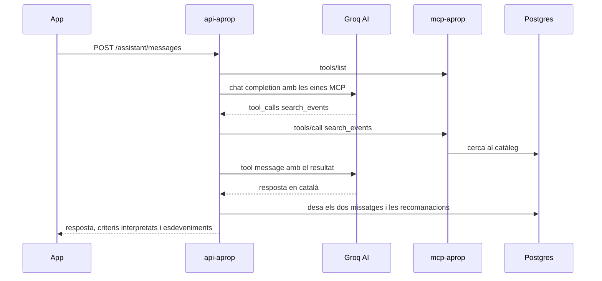

# api-aprop

Backend d'Aprop en Go. Té dos binaris:

| Binari | Ruta | Què fa |
|---|---|---|
| API | `cmd/app` | API HTTP (`PORT`, per defecte 8080). Aplica les migracions i importa els esdeveniments oficials en arrencar. |
| Servidor MCP | `cmd/mcp` | Exposa el catàleg d'esdeveniments com a eines MCP de només lectura (Streamable HTTP a `/mcp`, `MCP_PORT`). L'API el fa servir per al xatbot. |

## Arrencar en local

Cal un Postgres accessible. Totes dues aplicacions llegeixen les variables de l'entorn o de `.env.example` (vegeu-hi la llista).

```bash
go run ./cmd/app   # API; aplica les migracions
go run ./cmd/mcp   # servidor MCP del catàleg, en una altra terminal
```

El servidor MCP no aplica migracions: arrenca'l després que l'API hagi migrat la BD almenys un cop.

Amb Docker, la mateixa imatge conté els dos binaris:

```bash
docker build -t api-aprop .
docker run --env-file .env -p 8080:8080 api-aprop
docker run --env-file .env -p 8081:8081 --entrypoint /app/mcp api-aprop
```

Codi generat: les queries són a `internal/repositories/postgres/queries` i es generen amb `sqlc generate` (sqlc v1.31.1).
Atenció: `models.go` i `events.sql.go` s'han editat a mà, així que regenerar-ho tot els sobreescriu; copia només els fitxers de les queries noves.

## Xatbot (Assistent)



- Groq AI (Chat Completions API amb function calling) decideix quines eines MCP crida. L'API fa de client MCP.
- Els criteris interpretats són els arguments de la darrera cerca i els esdeveniments recomanats són els que ha retornat el catàleg real: el model no pot inventar-ne cap.
- Temps màxim de resposta: 8 s (NFR < 10 s). Si Groq AI o el MCP fallen, només falla aquesta petició (502/504) i no es desa res, així que l'app pot reintentar el mateix missatge.
- R12 es comprova al servei i a la BD (`CHECK` i clau forana): només els missatges del xatbot interpreten i recomanen; només els de l'usuari poden ser per veu.

### Endpoints

L'usuari s'identifica amb la capçalera `X-User-ID` (UUID) fins que hi hagi autenticació (`TODO(DP-011)`).

`POST /assistant/messages` amb `{"text": "concerts a Girona aquest cap de setmana", "by-voice": false}` respon `201`:

```json
{
  "conversation-started-at": "2026-10-19T14:30:00.123456Z",
  "user-message": { "sent-at": "…", "sender": "user", "text": "…", "by-voice": false },
  "assistant-message": {
    "sent-at": "…",
    "sender": "assistant",
    "text": "He entès: concerts a Girona aquest cap de setmana…",
    "by-voice": false,
    "interpretation": {
      "category": "concert",
      "municipality": "Girona",
      "date-from": "2026-10-24",
      "date-to": "2026-10-25",
      "date-range": "del 24/10/2026 al 25/10/2026"
    },
    "recommended-events": [ { "id": 7, "title": "…" } ]
  }
}
```

Els esdeveniments tenen el mateix format que `GET /events/{id}`. `interpretation` i `recommended-events` no hi són si no n'hi ha.

`GET /assistant/conversation` respon `200` amb `{"started-at": "…", "messages": [ … ]}` (la conversa més recent, per recuperar-la en tornar de la fitxa) o `404` si l'usuari encara no en té.

| Codi | Quan |
|---|---|
| 400 | Falta `X-User-ID`, no és un UUID, cos invàlid o text buit o de més de 1000 caràcters |
| 502 | Groq AI o el servidor MCP no responen correctament |
| 504 | El xatbot no ha respost en 8 s |
