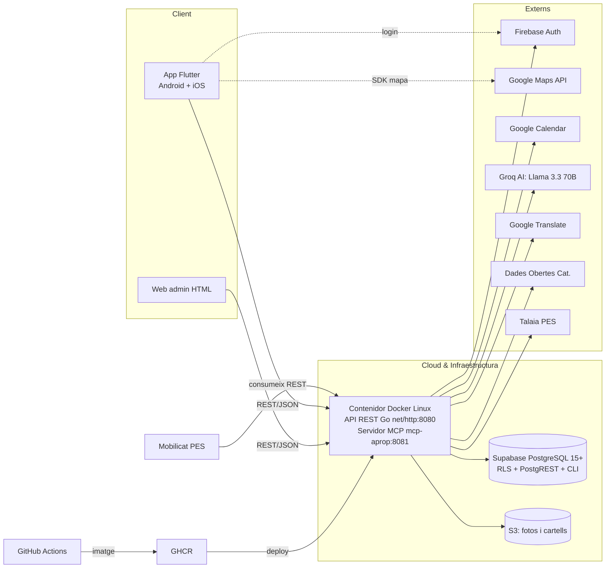

# 30 · Arquitectura

> **Quan llegir-ho:** quan un canvi travessa capes o repositoris, toca infraestructura, desplegament o serveis
> externs, o cal justificar una decisió. Per a l'estructura interna del backend Go, llegeix
> `docs/architecture.md` (font de veritat del servidor). Per al frontend Flutter, consulta el repo `frontend-aprop`.
> **Font:** `incepcio-2.pdf` §9, `memoria.pdf` §3.4 i estat de `api-aprop@develop`.

## Diagrama físic

## Regles d'arquitectura (vinculants)

1. **Punt d'entrada únic:** l'app mòbil, la web d'administració i els equips externs parlen exclusivament amb l'API REST. El client mòbil **mai** no accedeix directament a la base de dades.
2. **Lògica i permisos al servidor:** el client valida per a usabilitat; el servidor valida sempre la integritat i autorització.
3. **Backend sense framework:** només `net/http` de la biblioteca estàndard (ADR-0001). Dependències mínimes i auditades.
4. **Serveis externs darrere d'interfícies:** proves deterministes mitjançant fakes/mocks (`internal/clients/<x>_client/interface.go`).
5. **Fallada aïllada:** si cau Groq AI, Translate o Calendar, la navegació d'esdeveniments, el mapa i l'agenda continuen funcionant amb normalitat.
6. **Secrets només al backend:** `.env` local (ignorat a Git), secrets de GitHub Actions i variables d'entorn al contenidor de desplegament.
7. **Migracions versionades:** esquema gestionat amb migracions a `supabase/migrations/` i incrustades al binari Go amb `migrations.EmbedFS`.
8. **Seguretat amb RLS:** Row Level Security habilitat a totes les taules públiques de Supabase (ADR-0004).

## Capes del Backend (`api-aprop`)

- `cmd/app/main.go` → `internal/router` (`http.ServeMux` + `authMiddleware`)
  → `handlers/<x>_handler` (transport HTTP, validació, `response`)
  → `services/<x>_service` (lògica de negoci darrere d'interfície)
  → `repositories/postgres` (consultes tipades via `sqlc` sobre `pgxpool`)
  → `clients/<x>_client` (`gencat_client`, `groq_client`, `firebase_client`, `mcp_client`).
- Models de domini purs a `internal/models/<x>_model`.
- Servidor MCP separat a `cmd/mcp` per exposar les eines del catàleg al servei d'assistent intel·ligent.

## Entorns i desplegament

- Entorn local i producció basats en Docker. `.env` local ignorat i `.env.example` versionat amb documentació de variables.
- Integració contínua (CI) mitjançant GitHub Actions a cada PR (`go test ./...`, `go vet ./...`).
