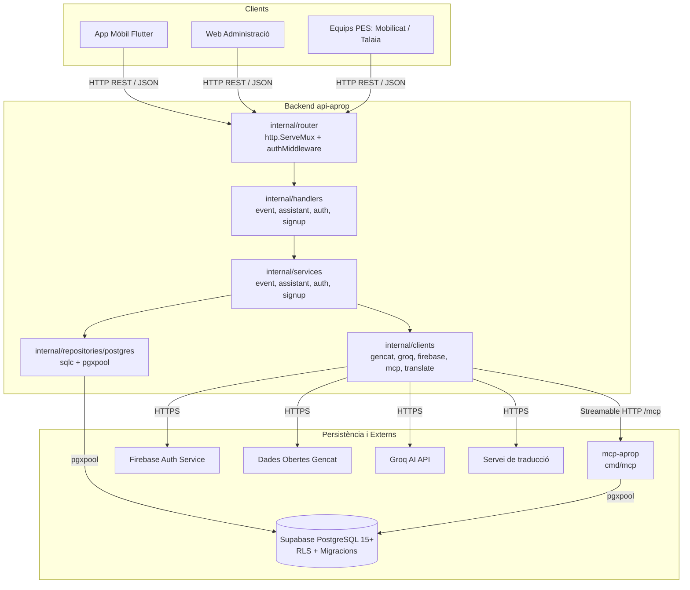

# Arquitectura del backend (`api-aprop`)

## Objectiu i estat

El backend `api-aprop` és una API REST construïda en **Go** que serveix com a punt d'entrada únic per a l'aplicació mòbil Flutter (`frontend-aprop`), la web d'administració i les integracions amb altres equips de PES (com Mobilicat i Talaia).

Seguim una arquitectura en capes inspirada en l'**Arquitectura Hexagonal (Ports i Adaptadors)**:
- El nucli del domini i la lògica de negoci (`services/` i `models/`) són completament independents del transport HTTP i del motor de base de dades.
- Els adaptadors primaris (`handlers/`) gestionen les peticions HTTP mitjançant la llibreria estàndard `net/http` sense frameworks externs (ADR-0001).
- Els adaptadors secundaris (`repositories/` i `clients/`) estan aïllats darrere d'interfícies en Go, facilitant proves unitàries deterministes mitjançant fakes o mocks.

## Diagrama físic i de flux



## Responsabilitats i estructura de paquets

| Ubicació | Responsabilitat |
|---|---|
| `cmd/app/main.go` | Punt d'entrada de l'API. Carrega configuració (`.env`), connecta amb Supabase, executa migracions, instancia i injecta dependències, i inicia el servidor HTTP. |
| `cmd/mcp/main.go` | Servidor MCP independent que exposa el catàleg d'esdeveniments com a eines MCP (Streamable HTTP a `/mcp`) per al xatbot. |
| `internal/router/` | Multiplexor de rutes HTTP (`http.ServeMux`). Aplica `authMiddleware` i registra els handlers de l'aplicació. |
| `internal/middleware/auth_middleware/` | Middleware d'autenticació que valida els tokens JWT de Firebase Auth i injecta el context d'usuari a la petició. |
| `internal/handlers/requester/` | Identifica qui fa la petició: `requester.ID` tradueix el UID de Firebase del context a l'UUID de la BD amb `auth_service.ResolveUserID` (sense middleware, llegeix l'UUID de `X-User-ID`). Sense identitat respon `401`; si el compte no ha fet `POST /auth/sync`, `401 user not registered`. Tots els handlers l'han de fer servir; els serveis reben sempre l'UUID. |
| `internal/handlers/<x>_handler/` | Adaptadors HTTP: parsegen peticions, validen formats d'entrada, invoquen el servei corresponent i serialitzen la resposta JSON utilitzant `handlers/response`. |
| `internal/services/<x>_service/` | Lògica de negoci de l'aplicació. Defineixen la seva interfície (`interface.go`) i orquestren repositoris i clients externs. |
| `internal/repositories/<x>_repository/` | Interfícies que defineixen les operacions de persistència de dades requerides pels serveis. |
| `internal/repositories/postgres/` | Implementació de la persistència en PostgreSQL (Supabase) utilitzant consultes tipades generades per `sqlc`. |
| `internal/clients/<x>_client/` | Clients HTTP per consumir serveis externs (`gencat_client`, `groq_client`, `firebase_client`, `mcp_client`, `translate_client`), cadascun darrere d'una interfície (`interface.go`). |
| `internal/models/<x>_model/` | Structs del domini amb tags de serialització JSON en kebab-case (`start-date`, `place-id`, etc.). `user_model.NormalizeID` / `ParseID` són l'única validació i conversió d'IDs d'usuari (UUID canònic). |
| `internal/drivers/postgres_driver/` | Configuració del pool de connexions amb PostgreSQL mitjançant `pgxpool`. |
| `supabase/migrations/` | Migracions oficials versionades de l'esquema de Supabase (amb suport per a Row Level Security). |
| `migrations/` | Migracions SQL incrustades (`embed.FS`) que s'apliquen automàticament en iniciar `cmd/app`. |

## Flux de dades d'una petició

```text
Petició HTTP (ex: GET /events/map)
       │
       ▼
internal/router (authMiddleware)
       │
       ▼
internal/handlers/event_handler.ListMapEvents
       │ (valida query params i context)
       ▼
internal/services/event_service.ListMapEvents
       │ (aplica regles de negoci i filtratge)
       ▼
internal/repositories/postgres.ListMapEvents
       │ (executa query SQL via sqlc sobre pgxpool)
       ▼
Base de Dades (Supabase PostgreSQL)
```

## Principis de disseny i regles d'enginyeria

1. **Sense framework web:** Només `net/http` estàndard amb el routing millorat de Go 1.22+ (`mux.HandleFunc("GET /events/{id}", ...)`).
2. **Contracte de JSON en kebab-case:** Totes les respostes i cossos de petició utilitzen claus en kebab-case (`start-date`, `tickets-url`, `is-closed`), d'acord amb el contracte establert amb el frontend.
3. **Respostes i errors estandarditzats:** El paquet `internal/handlers/response` centralitza l'enviament de respostes JSON d'èxit i missatges d'error coherents.
4. **Resiliència davant serveis externs:** Si un servei com Groq AI o Gencat cau, només es veu afectada la funcionalitat dependent (amb un codi 502/504), mantenint operatiu el catàleg i la navegació d'esdeveniments.
5. **Transaccions per a operacions compostes:** Quan una operació modifica més d'una taula o requereix consistència transaccional (com inscripcions amb decrement de places o tests de preferències), s'ha d'executar dins d'un bloc de transacció `pgx.Tx`.
6. **Aïllament de claus i secrets:** Les claus privades (credencials de servei de Firebase, claus de Groq AI, credencials de BD) només resideixen al backend a través de variables d'entorn (`.env`).
